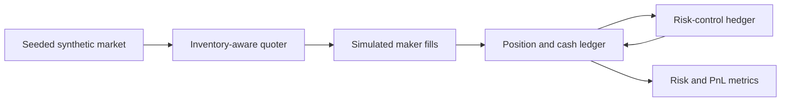

# Event-Driven Trading Lab

A standalone, deterministic **market-making and inventory risk-control simulator** built for engineering education. The application is deliberately independent of third-party trading exchanges and has no real market connectivity.

## What it demonstrates

- **Inventory-aware market making**: two-sided quotes shift away from accumulating inventory.
- **Two-tier risk management**: hard position caps prevent additional exposure, while soft thresholds trigger hedges.
- **Event-driven accounting**: signed fills update cash and position; P&L is marked to the final synthetic midpoint.
- **Reproducibility**: seeded synthetic events make tests and experiments deterministic.
- **Risk measurement**: peak and average absolute position are recorded before and after every hedge.

## Architecture



## Getting started

Requires Python 3.10 or later. No external runtime dependencies.

```bash
python -m pip install -e .
trading-lab --seed 42 --steps 1000
python -m unittest discover -s tests -v
```

Run without installation:

```bash
PYTHONPATH=src python -m trading_lab.cli --seed 42 --steps 1000
PYTHONPATH=src python -m unittest discover -s tests -v
```

For Windows PowerShell, use `$env:PYTHONPATH='src'` rather than `PYTHONPATH=src`.

The CLI outputs a JSON summary with mark-to-market P&L in **cents**, fill counts, and inventory-risk metrics. It does not claim historical trading profitability.

## Core design

**Quote generation.** The quoter shifts its reservation price by a fixed tick adjustment per unit of inventory. It publishes both sides unless the hard cap would be exceeded by a new fill. When long, bids become less aggressive; when short, asks become less aggressive.

**Execution.** An independent synthetic Bernoulli event chooses at most one maker fill per timestep. This is a simplification, not an order book or execution-quality model.

**Hedging.** Exposure beyond the soft limit is reduced through a marketable simulated hedge at a configurable slippage cost. Actual broker orders, asynchronous acknowledgments, and unfilled hedges are intentionally out of scope.

**Accounting.** Buy fills increase position and reduce cash. Sell fills do the reverse. Mark-to-market equity equals cash plus position multiplied by the final price. This is a zero-starting-cash P&L convention.

## Quality checks

Tests cover signed accounting, risk limiting, inventory skews, invalid input, deterministic runs, and no-fill behavior. CI executes the tests on supported Python versions.

## Limitations

This project is an **educational demonstration**. It does not establish expected trading returns: order flow is synthetic, execution is guaranteed when selected, market impact is absent, and there are no fees, queue positions, latency, order-cancel races, or regime changes. The parameters are illustrative, not calibrated to a live market. See [design and validation notes](docs/DESIGN.md).

## Provenance

This is an independently authored example based on general concepts in electronic trading and risk engineering. It is **not** an employer assessment, a redistribution of any employer's simulation, or a reproduction of any private exchange protocol. No employer-provided code, fixtures, prompt, transcript, branding, or grading setup is included.

## License

MIT. No investment advice. Not suitable for real-money trading.
